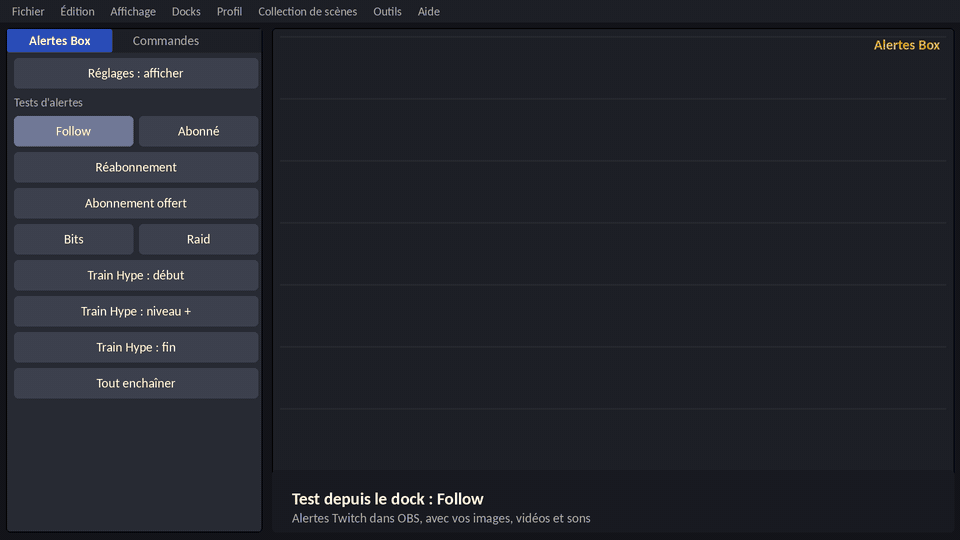

# Alertes Box – plugin OBS pour alertes Twitch

**Alertes Box** (nom technique : `obs-alertes-steampunk`) est un plugin pour [OBS Studio](https://obsproject.com) qui affiche tes alertes Twitch dans une carte au style steampunk, avec les images, vidéos et sons de ton choix. Il est construit à partir du [modèle de plugin officiel d'OBS](https://github.com/obsproject/obs-plugintemplate).

## Fonctionnalités

* **Un dock dans OBS** : réglage de la chaîne, installation de la source en un clic, boutons de test hors ligne, dans l'apparence native d'OBS.
* **Une page d'alerte fournie avec le plugin** : aucun hébergement, aucun service externe. Elle lit le chat Twitch en lecture seule, sans mot de passe et sans bibliothèque tierce.
* **Neuf alertes** : abonnement, réabonnement, abonnement offert, raid, bits, follow, et Hype Train (début, niveau, fin).
* **Tout se règle dans un seul fichier** (`alertes-config.js`) : textes, image, vidéo, son, volume, durée, couleur du cadre, taille du média, disposition (gauche, droite, dessus, dessous), position à l'écran, mode sans cadre, vidéo plein écran.
* **Commandes du chat** pour le streamer et les modérateurs : `!testalerte …` pour simuler une alerte, `!hype`, `!hype niveau N`, `!hype fin N` pour annoncer un Hype Train à la main.
* **Follows et Hype Train automatiques** (facultatif) grâce à une connexion à ta propre application Twitch.

## Compatibilité

| Élément | Détail |
|---------|--------|
| OBS Studio | 30 ou plus récent |
| Windows | 64 bits |
| macOS | Version universelle (Apple Silicon et Intel) |
| Linux | Ubuntu 24.04, 64 bits |

**État des essais** : le plugin a été installé et essayé sous **Windows**. Les versions macOS et Linux sont compilées automatiquement mais n'ont pas encore été essayées. Les follows et le Hype Train automatiques sont récents et n'ont pas encore été vérifiés avec de vrais événements.

## Installation

Télécharge la version de ton système dans les **Releases** du dépôt (ou dans les artefacts d'une exécution réussie de l'onglet *Actions*).

* **Windows** : copie le dossier `obs-alertes-steampunk` (il contient `bin` et `data`) dans `C:\ProgramData\obs-studio\plugins\`. Le résultat attendu est `…\plugins\obs-alertes-steampunk\bin\64bit\obs-alertes-steampunk.dll`.
* **macOS** : ouvre le paquet d'installation. Le plugin n'est pas signé : si macOS le bloque, autorise-le dans *Réglages Système, Confidentialité et sécurité*.
* **Linux** : installe le paquet `.deb`, ou copie le dossier du plugin dans `~/.config/obs-studio/plugins/`.

Relance OBS, puis ouvre le menu **Docks** et choisis **Alertes Box**. Le dock se rouvre ensuite automatiquement à chaque lancement d'OBS, rangé en onglet à côté du dock « Commandes » par défaut (il retient la position où tu le laisses) ; si tu le fermes volontairement (croix du dock ou case du menu **Docks**), ce choix est retenu.

## Utilisation

1. Dans le dock, écris le nom de ta chaîne Twitch.
2. Clique sur **Installer / mettre à jour la source** : la source Navigateur est créée dans la scène courante.
3. Clique sur un bouton de test pour voir l'alerte.
4. Ajoute la source dans chaque scène où tu veux les alertes, et décoche dans ses propriétés « Désactiver la source quand elle n'est pas visible » et « Actualiser le navigateur quand la scène devient active ».

Le champ **Options de l'adresse** accepte des réglages séparés par `&` : `volume=0.3`, `duree=10`, `types=sub,raid`, `minbits=100`, `raidmin=5`, `taille=1.3`, `son=0`, `follow=0`, `hype=0`, `demo=1` (affiche des boutons de test et l'état de la connexion).

## Personnaliser les alertes

Au premier lancement, le plugin copie ses fichiers dans le dossier de réglages d'OBS (le bouton **Ouvrir le dossier des réglages** y mène) :

* `alertes-config.js` : tes réglages, **jamais écrasé** par une mise à jour ;
* `medias/` : dépose ici tes images, vidéos et sons ;
* `alerte.html` : la page d'alerte, recopiée à chaque lancement d'OBS (ne la modifie pas) ;
* `reglages.json` : ce que tu as saisi dans le dock.

Après une modification, fais un clic droit sur la source dans OBS, puis **Actualiser le cache**.

## Follows et Hype Train automatiques

Twitch n'envoie ni les follows ni le Hype Train dans le chat. Pour les recevoir, il faut autoriser ta propre application Twitch :

1. Crée une application sur [dev.twitch.tv/console](https://dev.twitch.tv/console) avec `http://localhost` comme URL de redirection, catégorie *Application Integration*, type de client *Public*.
2. Ouvre `data/connexion-twitch.html`, colle l'identifiant client, autorise l'application, puis colle l'adresse reçue pour obtenir la ligne `clientid=…&token=…`.
3. Colle cette ligne dans **Options de l'adresse** du dock.

Le jeton est enregistré en clair dans `reglages.json` et sa durée est limitée : il faut le renouveler quand une alerte « Jeton Twitch expiré » s'affiche. Sans jeton, le Hype Train s'annonce avec `!hype` et les follows ne sont pas affichés.
